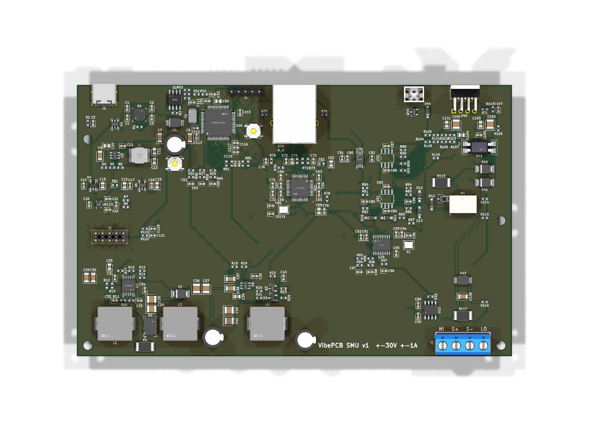
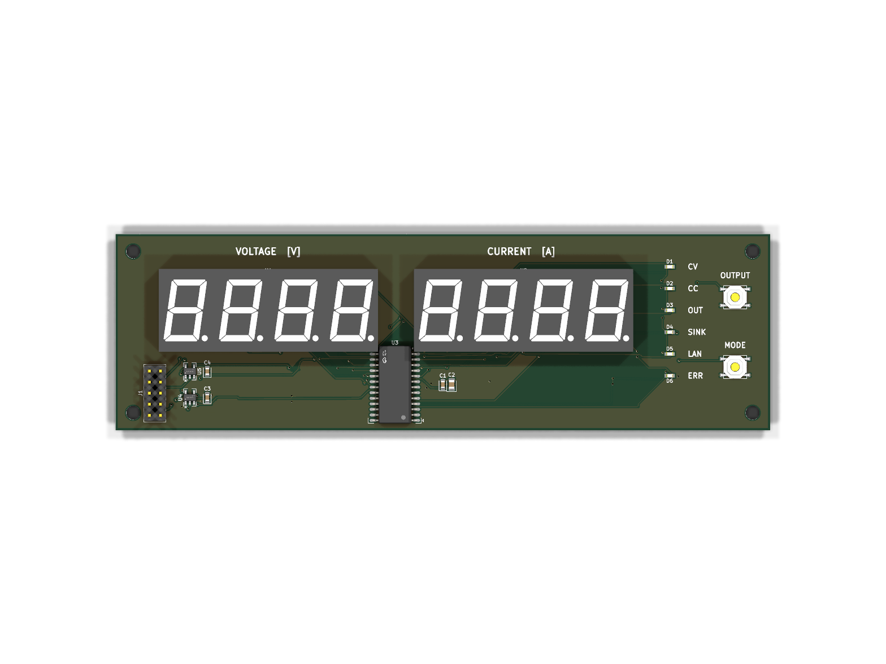

# VibePCB SMU

A 1-channel, 4-quadrant source/measure unit (bipolar lab supply that also sinks):
**+-30 V, +-1 A**, powered from a **USB-C PD charger (20 V)**, controlled over **Ethernet**,
voltage and current on two 4-digit 7-segment displays. Designed with
[VibePCB](https://github.com/PaulBichl/vibepcb) (tscircuit -> KiCad).

| Board | Layers | Size | Content |
|-------|--------|------|---------|
| `boards/smu-main` | 4 (top+GND / GND / route+GND / bottom+GND) | 160 x 100 mm | USB-C PD input, rail converters, OPA548 output stage, control loop, 24-bit measurement, STM32G431 + W5500 |
| `boards/smu-front` | 2 (both GND-poured) | 150 x 45 mm | 2x SR420561N displays, TM1640 driver, 6 status LEDs, OUTPUT / MODE buttons |

The boards are joined by a 10-way ribbon (main J5 <-> front J1). The output terminal (main J3:
HI, S+, S-, LO) is wired to front-panel binding posts; the OPA548 (TO-220-7) bolts to a heatsink
on the rear panel (with a fan on J4).

## Look at it




| | Main board | Display board |
|---|---|---|
| Schematic | [PDF](boards/smu-main/hardware/smu-main-schematic.pdf) | [PDF](boards/smu-front/hardware/smu-front-schematic.pdf) |
| Layout | [PDF, one page per copper layer](boards/smu-main/hardware/smu-main-layout.pdf), [front](boards/smu-main/hardware/smu-main-layout-front.png), [back](boards/smu-main/hardware/smu-main-layout-back.png) | [PDF](boards/smu-front/hardware/smu-front-layout.pdf), [front](boards/smu-front/hardware/smu-front-layout-front.png), [back](boards/smu-front/hardware/smu-front-layout-back.png) |
| 3D | [top](boards/smu-main/hardware/smu-main-top.png), [bottom](boards/smu-main/hardware/smu-main-bottom.png) | [top](boards/smu-front/hardware/smu-front-top.png), [bottom](boards/smu-front/hardware/smu-front-bottom.png) |
| BOM (LCSC / MPN) | [CSV](boards/smu-main/hardware/smu-main-bom.csv) | [CSV](boards/smu-front/hardware/smu-front-bom.csv) |
| KiCad project | [kicad/](boards/smu-main/hardware/kicad) | [kicad/](boards/smu-front/hardware/kicad) |

Both boards pass KiCad's DRC and ERC with 0 errors. The KiCad projects open as they are (3D
models left out: they are tens of MB; `pcb fix` downloads them). Gerbers / pick-and-place are
not in the repo: open the project in KiCad and plot them, or build the boards (below) and run
`hatch run pcb fab <board>` for Gerbers, drill, BOM, CPL and a JLCPCB upload set.

## Setup / build

Same as the [CO2 example](https://github.com/PaulBichl/vibepcb-example-co2-monitor): clone
`vibepcb` next to this repo as `VibePCB`, then

```bash
hatch run setup
hatch run pcb all smu-main
hatch run pcb all smu-front
cd boards/smu-main/sim && ./run_cases.sh && ./verify.sh   # loop simulations (ngspice)
```

## Architecture

```
USB-C PD (STUSB4500, 20 V) -> P-FET -> VIN -+-> 5 V buck -> 3.3 V (digital), 3.3 V (analog), -4.35 V (charge pump)
                                            +-> SEPIC (LM5156)            V+ = +4.5 .. +34 V  (PWM-tracked)
                                            +-> inverting (LMR51635)      V- = -5 .. -34 V    (PWM-tracked)
DAC8563 (VSET, ISET) -> summing node -> OPA548 -> relay -> HI ... DUT ... LO -> 0.1 R shunt -> GND
                          ^  ^  current-limit integrators (OPA2192) <- INA828 (-1 V/A)
                          |  +-- S+ (remote sense, 100 R to HI inside)
ADS131M02: V = (S+ - S-)/31, I = INA828 output    STM32G431 <-> W5500 <-> RJ45, TM1640 front panel
```

### Output stage

- OPA548 as inverting summing amplifier with remote sense:
  `V(S+) - V(S-) = 30 V - 24 * VSET` (VSET = DAC A, 0..2.5 V, 16 bit -> ~0.9 mV steps).
  The + input sees S- through the matching divider (120k / 3x 10k), so the shunt drop and the
  LO lead resistance are cancelled. S+/S- fall back to HI/LO through 100 R when no sense leads
  are connected (and to the amplifier output through 4.7k while the relay is open).
- Current limit +-ISET/2 A (ISET = DAC B): two integrators compare the INA828 output (-1 V/A)
  with +-ISET and pull the summing node through diodes. PI zero (12k * 47n) sits on the power
  stage pole (120k * 4.7n). Simulated: stable from a dead short to open circuit, with 10-100 uF
  loads, all four quadrants (`sim/`).
- Fast protection: the OPA548's own current limit, fixed at ~1.1 A by R109 (49.9k ILIM to V-,
  I = 15000 * 4.75 V / (13.75k + R)). It catches load steps in microseconds; the precise analog
  limit takes over within ~2-7 ms.
- Output relay (HFD4/5, both poles in parallel), output TVS (SMBJ36CA), clamp diodes from the
  amplifier output to both rails, 1 uF across the terminals. R118 (0.47 Ohm) between amplifier and
  relay keeps the OPA548 stable into capacitive loads (see Performance estimates).

### Tracking rails

The OPA548 only gets the headroom it needs, which keeps its dissipation low and the supply
span within its 60 V rating:

- Firmware: `V+ = max(Vout_max + 4 V, 4.5 V)`, `V- = min(Vout_min - 4 V, -5 V)` where
  Vout_max/min cover the setpoint and the measured output. Sourcing 1 A at 0 V dissipates ~4.5 W
  instead of ~34 W with fixed rails. Sinking is limited by physics (P = Vout * I goes into the
  heatsink): plan for a firmware power limit (e.g. 25 W, more with the fan).
- Hardware span clamp: a 51 V zener + 1k from V+ into the V- feedback node reduces |V-| when
  V+ - V- would exceed ~52 V, whatever the firmware does.
- At reset (MCU pins high-Z): both rails at minimum (pull-up / pull-down on the PWM pins),
  OPA548 hardware current limit 0 A, OPA548 disabled (opto LED on), relay open.

### Measurement

ADS131M02 (24 bit, simultaneous sampling, internal 1.2 V reference, 8.192 MHz oscillator):
- CH0: `(S+ - S-) / 31` through 0.1 % 300k/10k dividers -> +-36 V full scale.
- CH1: INA828 output, -1 V/A -> +-1.2 A full scale.

Firmware calibrates offset/gain of VSET, ISET and both ADC channels against a DMM (store in
flash) and can close a slow digital loop on top of the analog one.

## Performance estimates (simulated)

`boards/smu-main/sim/perf.sh` runs the loop with TI's vendor models (OPA548, INA828, OPA2192;
`fetch_models.sh` downloads them, they are not committed) in ngspice, rails tracking as the
firmware sets them. DAC8563 noise from its datasheet (90 nV/rtHz DAC + 250 nV/rtHz internal
reference, which also feeds REFN, so it cancels at 0 V out). Not simulated: switcher ripple /
PSRR, drift, INL, layout parasitics.

| Quantity | Estimate |
|----------|----------|
| Setting resolution | V: 0.92 mV (16 bit over 60 V), I limit: 19 uA (16 bit over 1.25 A) |
| Uncalibrated error (nominal parts) | V: +90 mV offset (OPA548 Vos/Ib x noise gain 37); I: +0.7 % gain (INA828 G = 9.93) - both removed by the 2-point calibration; 0.1 % resistors add ~0.15 % gain |
| Measurement noise (ADS131M02, 1 kSPS) | V: ~0.1 mVrms (3 uVrms x 31 divider); I: ~4 uArms (ADC + INA828) |
| Four quadrants | +-10 V / +-1 A source and +-11.5 V / 0.5 A sink cases regulate as set |
| Setpoint bandwidth | 270 Hz (-3 dB); 10-90 % rise 1.24 ms; within 10 mV of a 10 V step after ~4 ms; no overshoot with 1 / 10 / 100 uF loads |
| CV loop | phase margin 53 deg (1 uF on board only), 79 deg (+10 uF), 81 deg (+100 uF); crossover ~450 kHz |
| Output impedance (CV) | 23 mOhm at 10 Hz, 0.2 Ohm at 100 Hz, 0.59 Ohm at 1-10 kHz |
| Load step 0.5 -> 1 A at 10 V | dips 0.29 V, back within 10 mV after 0.63 ms |
| Short at 1 A limit | peak 1.20 A (OPA548 limit), within 1 % of 1 A after 6.6 ms; short removed: no overshoot |
| Output noise (10 Hz-100 kHz) | 97 uVrms at 0 V, 115 uVrms at 30 V; 1.15 uV/rtHz at 1 kHz |
| OPA548 dissipation at 1 A | source: 4-4.5 W (tracking rails); sink: (Vout + 5 V) x I, 35 W at +30 V |
| Heatsink (Tj <= 125 C, Ta 35 C) | 4.5 W: <= 18 K/W (passive); 25 W firmware limit: <= 1.7 K/W (fan); sink at 30 V / 0.71 A max under 25 W |
| USB-C PD input | worst case (source 30 V / 1 A) ~43 W -> ~2.2 A at 20 V: a 60 W (3 A) PD supply |

Found by the vendor models: the OPA548 oscillates into the 1 uF output capacitor (0.73 Vpp at
10 V out, `dc0_without_r118`); the behavioural model (`loop.cir`, single pole) hid it. R118
(0.47 Ohm, 2 W) between the amplifier and the relay isolates it; C104 keeps the fast feedback
on the amplifier side, the remote sense removes its DC drop.

## MCU pin map (STM32G431RBT6, LQFP-64)

No radio: control is over Ethernet only. Flashing: USB DFU over the USB-C (hold BOOT0 = SW2,
press RESET = SW1) or SWD on J6 (3V3, SWDIO, SWCLK, NRST, GND). 8 MHz crystal (Y2) on PF0/PF1.

| Pin | Function | Pin | Function |
|-----|----------|-----|----------|
| PA0 | VIN monitor (VIN/11), ADC1_IN1 | PB0 | PWM V+ (TIM3_CH3, high = minimum) |
| PA1 | V+ monitor (V+/16), ADC1_IN2 | PB1 | PWM V- (TIM3_CH4, low = minimum) |
| PA2 | V- monitor ((3.3*120k + V-*10k)/130k), ADC1_IN3 | PB10 | fan PWM (TIM2_CH3) |
| PA3 | NTC at the OPA548, ADC1_IN4 | PB7 / PA15 | I2C1 SDA / SCL (STUSB4500) |
| PC13 | STUSB4500 ALERT | PC9 | output relay |
| PC8 | OUT_EN: drive low to enable the OPA548 | PA7 / PA5 / PA6 | SPI1 MOSI / SCK / MISO (ADC + DAC) |
| PA4 / PC4 | ADC CS / DAC CS | PA11 / PA12 | USB D- / D+ (DFU + CDC over USB-C) |
| PC5 / PB2 | ADC DRDY / SYNC-RESET | PB12 / PC6 / PC7 | W5500 CS / INT / RST |
| PB15 / PB13 / PB14 | SPI2 MOSI / SCK / MISO (W5500) | PC0 / PC1 | buttons OUTPUT / MODE |
| PC2 / PC3 | display DIN / CLK (TM1640) | | |

Pins are assigned by side: each signal leaves the package on the side facing its destination
(fewer crossings under the chip, easier fan-out). The OPA548 current limit is fixed (R109).

## Firmware notes (not part of this repo yet)

- STUSB4500: program the NVM once to request 20 V (PDO3) so it negotiates without the MCU.
  Without PD (5 V USB from a PC) the logic runs (flashing, Ethernet) but the rails stay off
  (converter UVLO ~13 V).
- DAC8563: enable the internal reference after power-up.
- Output on: rails -> E/S enable -> setpoint ramp from 0 V -> relay. Output off in
  reverse; never switch the relay with current flowing.
- Watchdog: if the firmware stalls, the pins keep their last state; use the STM32 independent watchdog (IWDG)
  to reset (which returns everything to the safe defaults above).
- Remote interface: SCPI over raw TCP (port 5025) is the natural choice.

## Known limits / ideas for v2

- The output is ground-referenced (LO = GND = USB-C GND). With an earthed charger, LO is earthed.
- Single current range (1 A, ~1 uA ADC resolution but INA828 offset ~ +-0.15 mA): a second
  range (10 mA, 10 R shunt) would make it a real low-current SMU.
- Sink power is burned in the OPA548; a regenerative output stage would be the next step.
- Loop compensation and the converter compensation values come from simulation / datasheet
  rules of thumb: verify on the bench (step response, capacitive loads).
